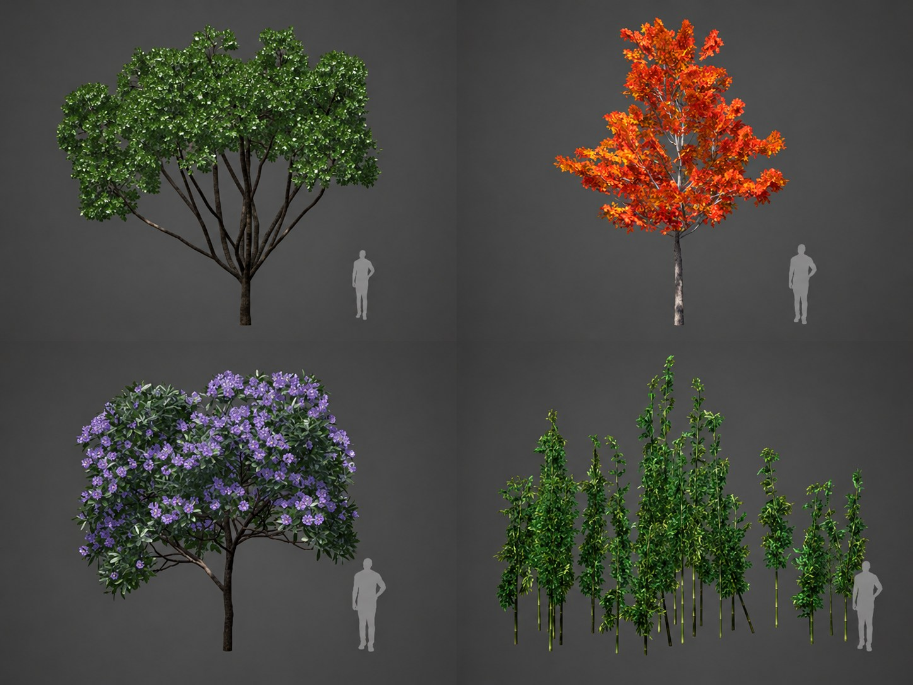

# 资产库投稿填写示例

以已发布的 **DTS_Library_v6 6.0.0** 为例，下面的标题与 Issue 表单字段一一对应。
这是参考写法，不是待投稿资源；请替换成自己的内容、文件链接、署名与真实授权情况。

[查看实际资源](https://mr-pardon.github.io/verdflow-resources/?type=assets&id=dts-library&version=6.0.0) ·
[填写投稿表](https://github.com/Mr-Pardon/verdflow-resources/issues/new?template=resource-submission.yml) ·
[策略示例](strategies.md) · [种植方案示例](plans.md)

## 资源类型

资产库（VFA）

## 资源名称与版本

DTS_Library_v6 / 6.0.0

## 介绍与预览图

面向 DTS 植被种植的资产目录，包含 596 项资产、596 张缩略图、8 个分类，
涵盖乔木、灌木、竹类、棕榈与花草。在植被搭配中可按分类浏览并选择模型。

适用平台：飞渡 DTS。用于 VerdFlow 的 DTS 植被搭配与种植流程。
建议先用少量选区检查模型是否可用及缩放是否合适。

VFA 包含名称、模型引用、分类和缩略图，不包含三维模型或 PAK。
使用前需另行准备配套 PAK；导入 VFA 不等于已经安装模型。
参考半径、参考高度等可选字段以单项记录为准，不能视为全库均已标定。

## 包文件链接与关联资源

- VFA：[DTS_Library_v6.vfa](https://github.com/Mr-Pardon/verdflow-resources/releases/download/assets-dts-library-v6.0.0/DTS_Library_v6.vfa)
- 配套 PAK：[百度网盘下载入口](https://pan.baidu.com/s/1Te07ATBL0UrvJVowNR5k8w?pwd=sp4c)，提取码 `sp4c`。
- 不绑定某一策略，可在支持 DTS 模型的植被搭配中选材。

## 作者署名

Mr_Pardon

## 许可与素材来源

目录整理与发布：Mr_Pardon。

模型、缩略图与 PAK 的使用遵循原资源授权，不因被 VerdFlow 收录而转为 Apache-2.0 授权。
VFA 只分发目录与缩略图，模型本体通过上述外部 PAK 入口获取。

## 投稿确认

提交自己的资源时，核对并勾选表单中的两项声明：

- 已移除私人路径、项目资料与凭据，确认拥有所提交内容的分发权。
- 理解资源收录不代表策略安全认证，也不会自动授予客户端执行信任。

## 换成你的资产库时

- 配套 PAK 没有公开下载地址时，写明合法的获取方式；不需要 PAK 的平台可写“不适用”。
- 自己的投稿还应写明第三方素材的原作者、出处与许可或授权依据，不能只照抄“遵循原资源授权”。无权分发的模型和缩略图不要提交。
- 如果尚未托管 VFA，可提供维护者能够公开获取的临时文件链接，由审核后整理为固定 Release 附件；无需自行创建资源中心 Release。
- 无需编写 `resource.json` 或手算文件大小、SHA-256，维护者会核验包身份、文件和关联信息。
