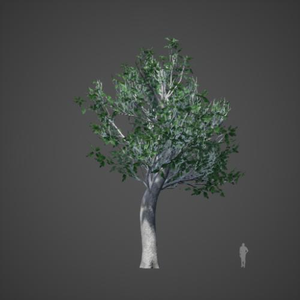

# DTS_Library_v6

面向 DTS 植被种植的资产目录，包含 **596 项资产、596 张缩略图、8 个分类**。
在 VerdFlow 中浏览植被、配置角色与缩放；模型本体通过配套 PAK 单独获取。

## 包含哪些内容

| 分类 | 资产数 |
| --- | ---: |
| 常绿灌木 | 27 |
| 落叶灌木 | 5 |
| 常绿乔木 | 74 |
| 落叶乔木 | 203 |
| 针叶类 | 89 |
| 竹类 | 13 |
| 棕榈类 | 19 |
| 花草 | 166 |

VFA 包含资产名称、DTS 模型引用、分类及预览缩略图，不包含三维模型或 PAK。
参考尺寸等可选字段以各项资产实际记录为准，不能视为所有植被均已标定。

## 开始使用

1. 下载本页的 VFA，在 VerdFlow 的“资产库”中导入。
2. 从“配套 PAK”入口获取对应资源，在 DTS 中完成资源准备。
3. 在植被搭配中选择此资产库，为策略的已启用角色选择植被。
4. 先用少量选区检查模型可用性和缩放，再执行批量种植。

[获取配套 PAK（百度网盘，提取码 sp4c）](https://pan.baidu.com/s/1Te07ATBL0UrvJVowNR5k8w?pwd=sp4c)

VFA 导入成功不代表 PAK 已安装；资源中心只提供外部入口，不托管或验证 PAK 内容。
[资产库使用指南](https://mr-pardon.github.io/verdflow-site/resources/assets.html)

## 版本与许可

本页分发版本为 **6.0.0**，对应 DTS_Library_v6；VFA 内部格式版本仍为 1。
公开资产库标识为 `dts_library`，后续更新保留这一身份。

资产库设计：**飞渡DTS**。目录整理与发布：**Mr_Pardon**。
模型、缩略图与 PAK 的使用遵循原资源授权，
不因被 VerdFlow 收录而转为 Apache-2.0 授权。
