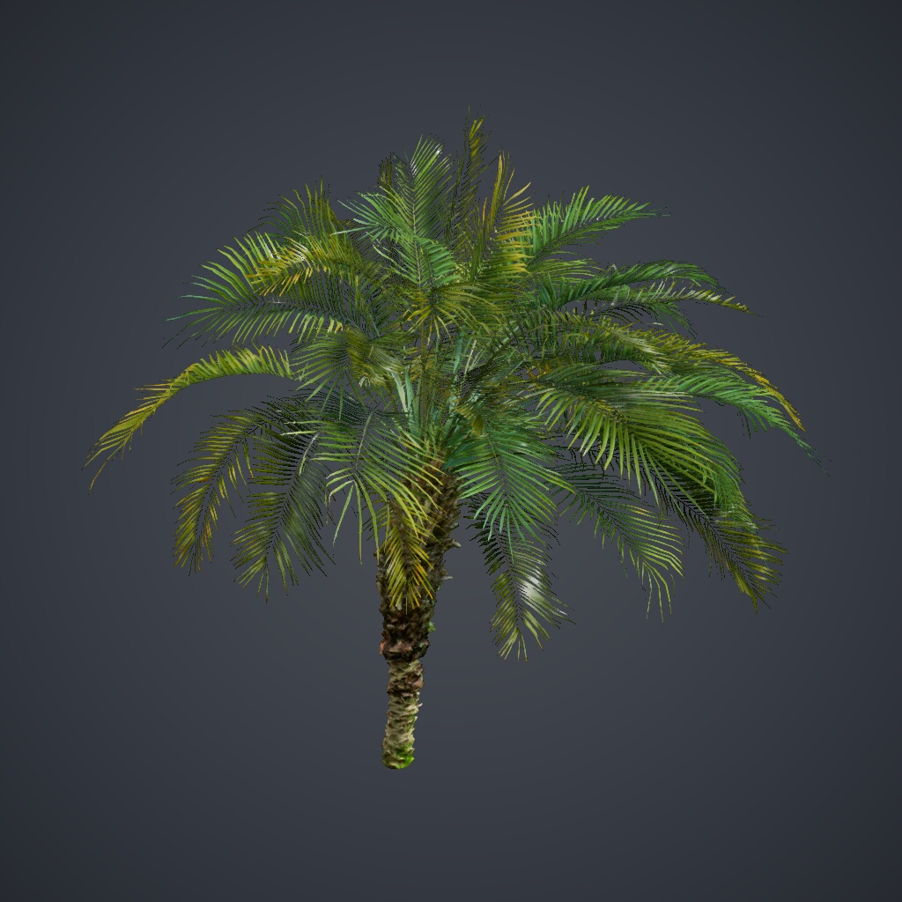

# Weekly_Library

面向飞渡 DTS 的植被与小品资产库，依据 **2026-10-24** 的 PAK 统计清单整理。
包含 **179 项资产、5 个分类**，其中植被 169 项、小品 10 项；每项均附预览缩略图。

## 包含哪些内容

| 分类 | 资产数 |
| --- | ---: |
| 小品 | 10 |
| 常用乔木 | 75 |
| 常用棕榈 | 18 |
| 常用灌木 | 11 |
| 常用花草 | 65 |

VFA 保存名称、精确 DTS 模型引用、分类、缩略图和已有的参考尺寸，不包含三维模型或 PAK。
179 项目录条目对应 178 个独立静态网格；棕榈_01 与棕榈_04 共享同一网格，保留为两个目录条目。
缩略图在包内按内容去重，共 177 个图片资源，不影响各项资产的预览。

## 参考尺寸与 LOD

- 163 项植被保存了参考半径和参考高度，单位为米，对应模型统一缩放为 1.0 时的尺寸。
- 5 项新增棕榈、1 项新增修剪灌木及 10 项小品尚未填写参考尺寸，不根据常见植物尺寸推测补齐。
- LOD 数据保留统计清单已提供的面数和记录来源。部分新增模型的低级别面数与切换阈值尚未记录，未知值不会写成 0。
- 参考尺寸用于选材与参数示意，不代表碰撞保证；实际模型大小、显示和远景细节以 DTS 中的 PAK 为准。

## 开始使用

1. 下载本页 VFA，在 VerdFlow“资产库”中导入。
2. 从下方 PAK 入口获取 **Weekly_Library_1024.pak**，在 DTS 中完成资源准备。
3. 在植被搭配中选用“Weekly 植被资产库”，为策略启用的角色选择素材。
4. 先用小范围选区核对模型、缩放和远景效果，再执行批量种植。

[配套 PAK（百度网盘，提取码 ki35）](https://pan.baidu.com/s/1zZZEnBxxpjTkVcc7VYlbcQ?pwd=ki35)

导入 VFA 不等于安装 PAK，资源中心不托管或自动安装 PAK。
来源资产库只帮助追溯和继续选材，已保存种植方案仍使用自身的模型引用与配置快照；
导入或更新资产库不会静默替换方案中的模型、权重、缩放或参数。

[资产库使用指南](https://mr-pardon.github.io/verdflow-site/resources/assets.html)

## 版本与许可

本页首次公开分发版本为 **1.0.0**，对应 2026-10-24 整理的资产清单；不是 VFA 内部格式版本。
公开库标识为 `weekly_library`，后续更新保持这一身份。

目录整理与发布：**Mr_Pardon**。模型、缩略图与 PAK 的使用遵循原资源授权，
不因被 VerdFlow 收录而转为 Apache-2.0 授权。封面仅展示库内模型，不承诺特定种植效果。
