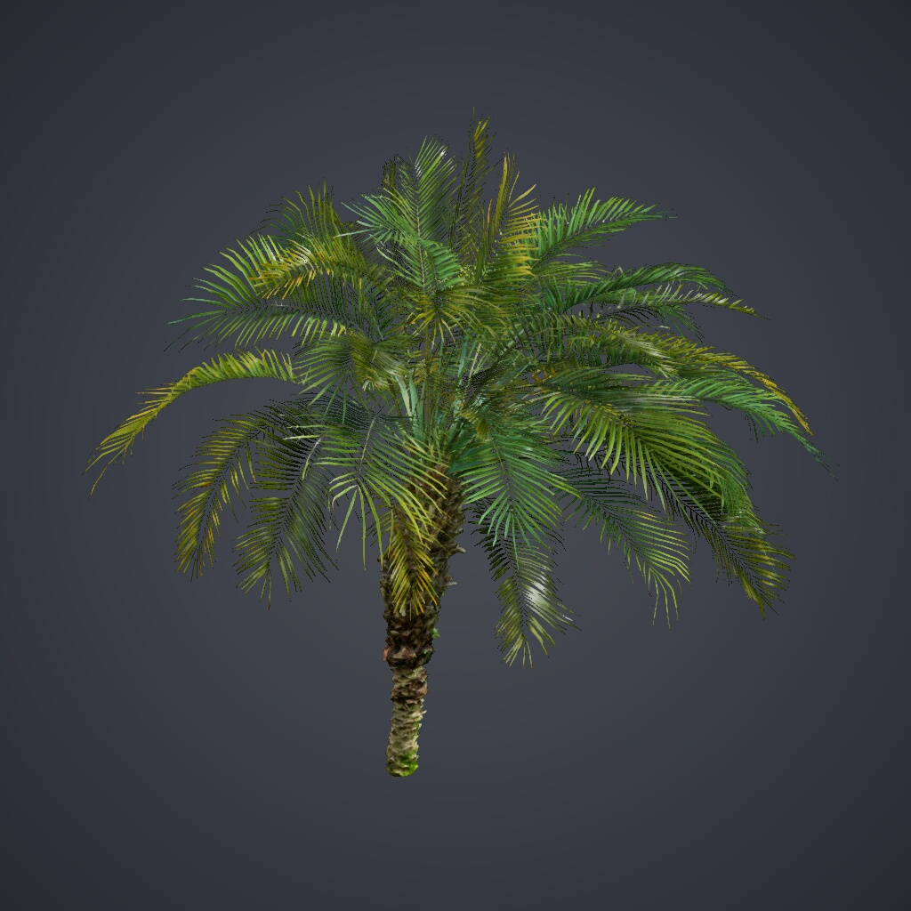

# Weekly_Library · 1112

面向飞渡 DTS 的植被与小品资产库，依据 **Weekly_Library_1112.pak** 对应的统计清单整理。
包含 **177 项资产、6 个分类**，其中植被 167 项、小品 10 项，均附预览缩略图。

## 资产分类

| 分类 | 资产数 |
| --- | ---: |
| 常用乔木 | 68 |
| 常用棕榈 | 20 |
| 常用灌木 | 11 |
| 常用花草 | 65 |
| 面片树 | 3 |
| 小品 | 10 |

相较 1024 版，新增 6 项、移除 8 项，另将 3 项面片树独立归类。
171 项保留原资产 ID 与 DTS 模型引用；155 项沿用已有的参考半径和高度，未填写的尺寸不作推测。

## 开始使用

1. 在 VerdFlow 的资产库中导入 **Weekly_Library_1112.vfa**。
2. 从 [百度网盘（提取码 ih16）](https://pan.baidu.com/s/1vh8MZcOAxIEBknDC1Qp88Q?pwd=ih16) 获取 **Weekly_Library_1112.pak**，在 DTS 中另行准备模型。
3. 先用小范围选区核对模型与缩放，再执行批量种植。

VFA 不包含模型，也不会自动安装 PAK。资产库更新不会改写已保存种植方案的模型引用、权重、缩放或参数。
“影像面片树”和“通用绿植铺设”所引用的模型在 1112 版仍保留。其他旧方案若使用了本次移除的模型，建议先核对 DTS 资源，必要时使用 1024 历史版本。

[资产库使用指南](https://mr-pardon.github.io/verdflow-site/resources/assets.html)

## 版本与许可

**1.1.0** 是资源中心分发版本，库标识仍为 `weekly_library`。
资产库设计：**飞渡DTS**。目录整理与发布：**Mr_Pardon**。
模型、缩略图与 PAK 的使用遵循原资源授权。
