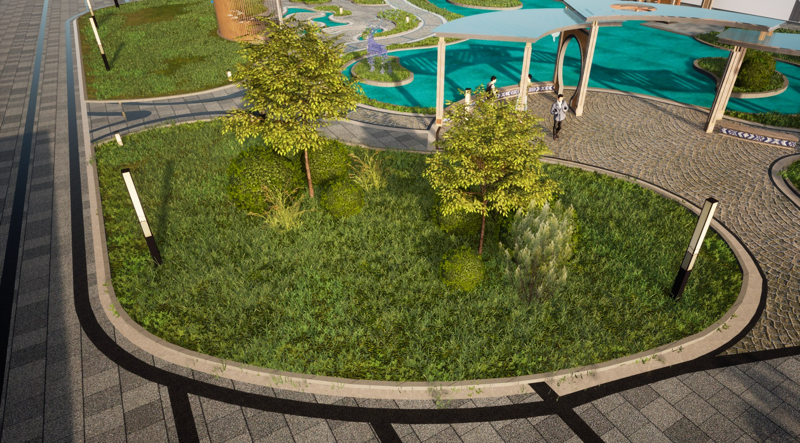

# 花坛点景

适用于花坛与小型景观绿地的种植预设：以主体草坪和收边草坪形成底面，
搭配主景乔木、组团灌木与外围点缀，保存了 **5 种已启用用途、7 种植被**及种植参数。

图为使用场景中的效果示例，周围建筑、铺装、灯具等设施不随 VFP 分发。

## 植被搭配

| 用途 | 植被 | 缩放 | 用途内权重 |
| --- | --- | --- | --- |
| 主体草坪 | 草坪_4 | 150%-200% | 100% |
| 收边草坪 | 草坪_9 | 90%-110% | 100% |
| 中心主景 | 梣叶槭 | 100%-250% | 100% |
| 组团灌木 | 黄杨_B | 80%-180% | 100% |
| 外围点缀 | 草坪_11 | 80%-150% | 20% |
| 外围点缀 | 草坪_10 | 80%-140% | 20% |
| 外围点缀 | 沙漠扫帚_A | 90%-180% | 60% |

缩放范围为方案保存的随机缩放配置，实际植被大小仍取决于 DTS 中对应模型的原始尺寸。

## 已保存的效果参数

| 参数 | 配置 |
| --- | --- |
| 主体草坪间距 | 1.5 米 |
| 点景组团密度 | 3.5 |
| 主景植被出现概率 | 85% |
| 点景组团数量下限 | 2 |

以上参数随 VFP 一起导入，可按地块尺寸、植被原始大小和期望疏密继续微调。

## 开始使用

1. 导入并信任关联的“草坪点景组团”策略；本方案保存于 1.0.2。
2. 通过配套 PAK 入口准备 DTS 模型资源。
3. 下载本页 VFP，在 VerdFlow“种植方案”中导入。
4. 在工作台或实时种植面板选择“预设方案”，选用“花坛点景”并指定种植区域。
5. 需要调整时进入方案配置，微调植被缩放、角色或效果参数。

关联的 DTS_Library_v6 可用于追溯植被和继续选材。VFP 已携带模型引用、权重、缩放和参数快照，
使用方案不额外要求安装来源资产库，DTS 中仍需有对应模型。

[种植方案使用指南](https://mr-pardon.github.io/verdflow-site/resources/mixes.html)

发布者：**Mr_Pardon**。方案配置按 **Apache-2.0** 发布；植被模型、PAK 与场景素材遵循原资源授权。
