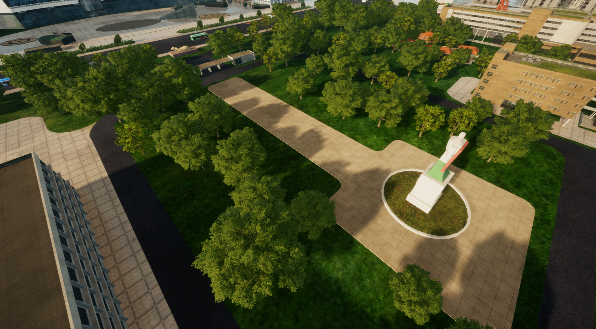

# 通用绿植铺设

面向园区与一般绿地的乔木混合种植预设，使用“层次生态群落”策略形成自然疏密变化。
仅启用 **主景植被**，搭配 Weekly_Library 中的 **3 种乔木**：两种阔叶树与五桠果。
铺底植被已关闭，本方案不生成草坪或灌木。

图为使用场景中的效果示例。画面中的草地、建筑、道路、铺装及其他设施不随 VFP 分发，
也不是本方案的生成内容。实际效果仍取决于地块、采样高程、模型资源与观察视角。

## 植被搭配

| 用途 | 植被 | 缩放 | 用途内权重 |
| --- | --- | --- | --- |
| 主景植被 | 阔叶_02_Med | 55%-100% | 52% |
| 主景植被 | 阔叶_01_Med | 90%-130% | 19% |
| 主景植被 | 五桠果_01_Med | 100%-150% | 29% |

权重用于候选植被的随机分配，不保证每次生成的精确数量比例。
缩放范围为方案保存的随机缩放配置，实际大小仍取决于 DTS 中模型的原始尺寸。
方案还保留了三种植被的参考半径与高度，供参数示例等展示使用。

## 已保存的效果参数

| 参数 | 配置 |
| --- | --- |
| 主景覆盖比例 | 78% |
| 主景植被间距 | 15 米 |
| 宏观斑块尺度 | 40 米 |

铺底植被处于关闭状态，方案保留的铺底覆盖率 85%、间距 3.4 米不用于本次铺底生成。
如需补充地表层，可在配置中启用铺底角色并选择相应植被。

## 开始使用

1. 导入并信任关联的“层次生态群落”策略；本方案保存于 2.2.2。
2. 通过配套 PAK 入口准备 DTS 模型资源。
3. 下载本页 VFP，在 VerdFlow“种植方案”中导入“通用绿植铺设”。
4. 在工作台或实时种植面板选择“预设方案”，选用该方案并指定种植区域。
5. 根据地块尺寸、树木原始大小和期望疏密，微调主景间距、覆盖比例、斑块尺度或植被缩放。

来源资产库为 **Weekly_Library**（公开标识 `weekly_library`），可用于追溯植被和继续选材。
VFP 已携带模型引用、权重、缩放和参数快照，使用方案不额外要求安装来源资产库，
DTS 中仍需有对应模型。

[种植方案使用指南](https://mr-pardon.github.io/verdflow-site/resources/mixes.html)

方案设计与发布：**Mr_Pardon**。来源资产库设计：**飞渡DTS**。
方案配置按 **Apache-2.0** 发布；植被模型、PAK 与场景素材遵循原资源授权。
