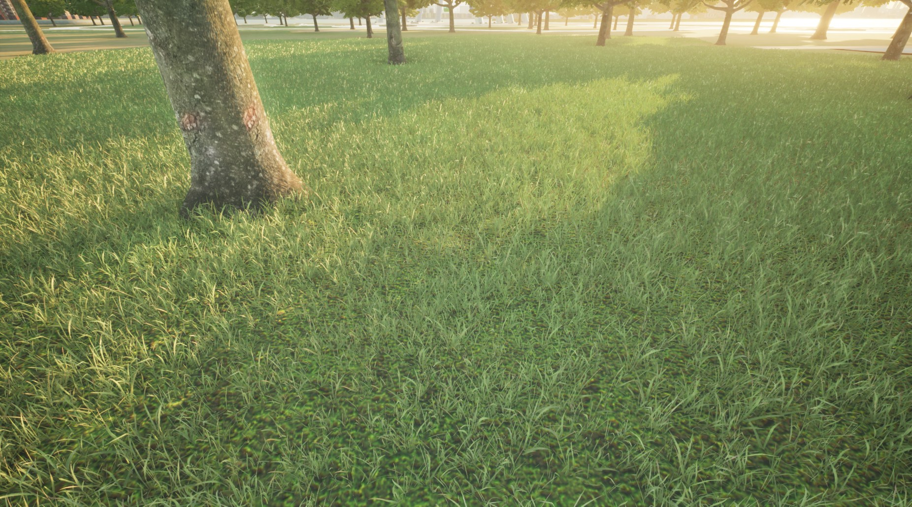

# 草坪铺设

用于快速铺设连续草坪的轻量预设，仅启用 **主体草坪与收边草坪**，
保存了两种草坪素材、各自的缩放范围与种植参数。
中心主景、组团灌木和外围点缀均已关闭。

图中乔木属于原有场景，本方案只生成草坪，不新增乔木或点景组团。

## 植被搭配

| 用途 | 植被 | 缩放 | 用途内权重 |
| --- | --- | --- | --- |
| 主体草坪 | 草坪_4 | 150%-200% | 100% |
| 收边草坪 | 草坪_9 | 90%-110% | 100% |

主体草坪间距预设为 **1.5 米**。两种素材分别承担内部覆盖与边缘补齐，
实际覆盖效果由素材尺寸、缩放及地块形状共同决定。

## 开始使用

1. 导入并信任关联的“草坪点景组团”策略；本方案保存于 1.0.2。
2. 通过配套 PAK 入口准备 DTS 模型资源。
3. 下载本页 VFP，在 VerdFlow“种植方案”中导入。
4. 在工作台或实时种植面板选择“预设方案”，选用“草坪铺设”并指定区域。
5. 根据实际草坪模型的尺寸，微调主体间距或缩放范围。

关联的 DTS_Library_v6 可用于追溯植被和继续选材。VFP 已携带草坪配置快照，
使用方案不额外要求安装来源资产库，DTS 中仍需有对应模型。

[种植方案使用指南](https://mr-pardon.github.io/verdflow-site/resources/mixes.html)

发布者：**Mr_Pardon**。方案配置按 **Apache-2.0** 发布；植被模型、PAK 与场景素材遵循原资源授权。
