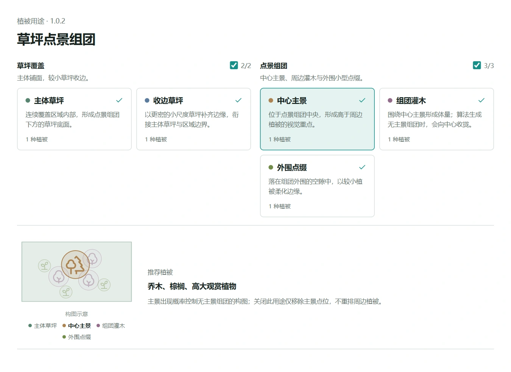

# 草坪点景组团

以主体草坪和收边草坪形成连续覆盖，再按需叠加主景、灌木与外围点缀。
适合花坛、草坪及小型景观绿地；关闭点景用途后，也可单独铺设草坪。

## 五种植被用途

| 用途 | 构图作用 |
| --- | --- |
| 主体草坪 | 覆盖地块内部的主要草坪区域 |
| 收边草坪 | 以较密的点位补齐边缘覆盖 |
| 中心主景 | 点景组团的中心植被 |
| 组团灌木 | 围绕主景组织低矮植被 |
| 外围点缀 | 在组团周围提供更松散的变化 |

各用途可以独立启停，具体植被与缩放由搭配配置提供。
不需要为纯草坪铺设配置全部五种用途。

## 调整效果

- 主体草坪间距影响点位疏密；覆盖是否连续还与所选模型尺寸和缩放有关。
- 点景组团密度影响区域内部的组团数量。
- 主景出现概率影响组团内是否出现中心主景。
- 包内包含弧形内凹花坛样本，可在参数示例中观察变化。

## 使用与版本

下载 VFS 后导入策略库，核对来源并确认信任，再为启用的用途选择植被。
**1.0.2** 增加花坛参数示例，生成算法不变。
策略不绑定特定模型库，VFS 也不包含植被模型。

[策略使用指南](https://mr-pardon.github.io/verdflow-site/resources/strategies.html)

作者：**Mr_Pardon**。策略代码按 **Apache-2.0** 发布。
