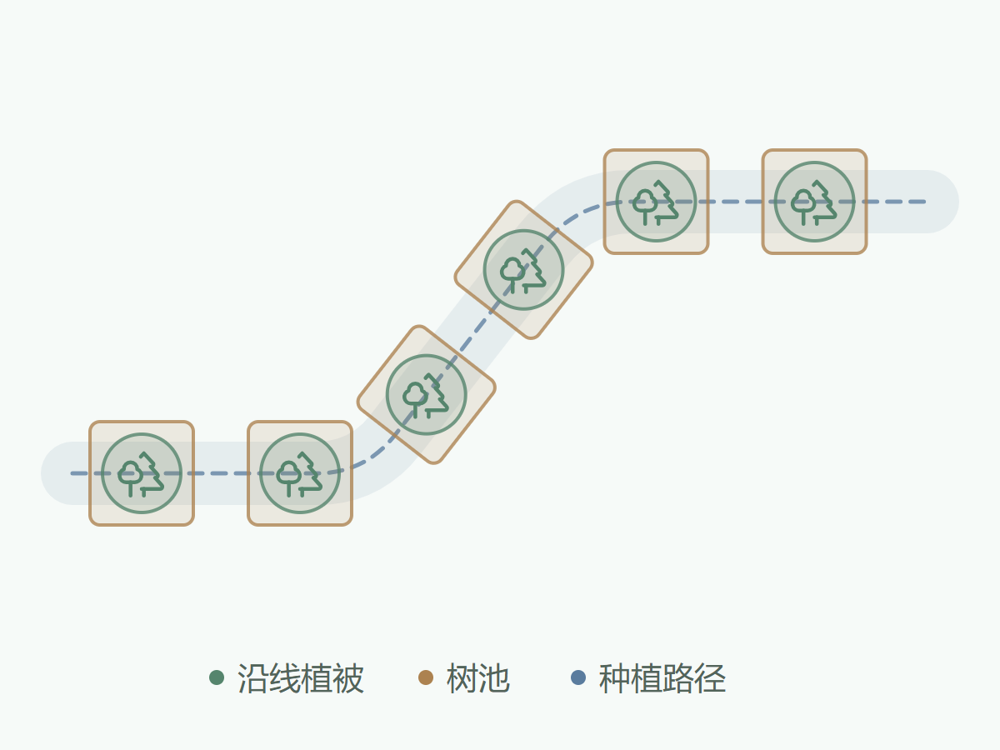

# 沿线树池种植

**使用要求：VerdFlow 1.1.0 或更高版本。** 适用于 DTS 实时种植的沿线绘制入口。
输入必须为开放折线，不适用于工作台的面选区、闭合环线或道路绿带 Polygon。

沿整条路径累计计距，在每个等距位置布置植被及可选树池。转角处不重新计距，
可启用圆滑过渡，植被与树池仍共享布置位置。

图为构图示意，浅蓝虚线表示路径，绿色符号与赭色方框分别表示植被和树池。
示意不代表实际冠幅、树池尺寸或 DTS 渲染结果。

## 角色搭配

| 角色 | 组织方式 | 配置建议 |
| --- | --- | --- |
| 植被 | 沿线等距布置，水平朝向独立随机 | 乔木或观赏灌木，可设置随机缩放 |
| 树池 | 可选，与植被共位置，沿路径切线排列 | 树池或围框，建议使用固定缩放和贴地原点 |

关闭树池不会改变剩余植被的点位或朝向。实际模型和缩放由植被搭配指定，
策略包不携带模型或 PAK。

## 效果参数

| 参数 | 默认值 | 效果 |
| --- | --- | --- |
| 沿线间距 | 8 米 | 按整条路径累计距离布置，不在折点重置 |
| 起点留距 | 0 米 | 从起点预留指定距离，终点不强制补齐 |
| 转角圆滑半径 | 0 米 | 0 保留折角；增大时沿圆弧过渡，实际半径受短线段限制 |

## 开始使用

1. 确认客户端为 VerdFlow 1.1.0 或更高版本，从本页下载 VFS 并导入策略库。
2. 核对来源并确认信任，在 DTS 实时种植中选择该策略，绘制开放折线。
3. 按需配置植被、树池与缩放，通过参数示意检查间距、留距和转角效果。

导入策略不会自动授予执行信任。请在 DTS 中另行准备对应模型资源。

[策略使用指南](https://mr-pardon.github.io/verdflow-site/resources/strategies.html)

作者：**Mr_Pardon**。策略代码按 **Apache-2.0** 发布。
