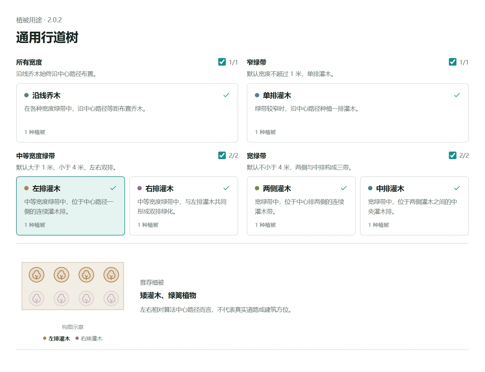

# 通用行道树

面向道路分隔带、道路附属绿带与主轴明确的狭长地块。
沿局部截面推导中心路径，按宽度组织灌木，并沿路径布置等距乔木。

## 根据地块宽度组织植被

| 局部宽度 | 灌木组织方式 |
| --- | --- |
| 不超过 1 米 | 中心单行 |
| 大于 1 米、小于 4 米 | 左右双带 |
| 不小于 4 米 | 两侧与中心三带 |

各模式均可使用沿中心路径的乔木点缀。植被用途和角色开关在搭配面板中配置，
具体模型与缩放不由策略绑定。

## 适用范围

优先使用狭长、连续、方向明确的 Polygon 地块。
它不是道路中心线输入工具，也不适合直接用于广场或大块不规则绿地。
复杂分叉或强烈收缩的地块建议先拆分，再检查局部种植效果。

包内包含单一 **160 × 6 米**道路绿带参数示例，用于观察间距与排布变化。

## 使用与版本

下载 VFS 后导入策略库，核对来源并确认信任，再选择需要启用的植被用途。
**2.0.2** 增加道路绿带参数示例，生成算法不变。
资源中心不执行策略，也不自动授予客户端信任；模型需在目标平台中另行准备。

[策略使用指南](https://mr-pardon.github.io/verdflow-site/resources/strategies.html)

作者：**Mr_Pardon**。策略代码按 **Apache-2.0** 发布。
