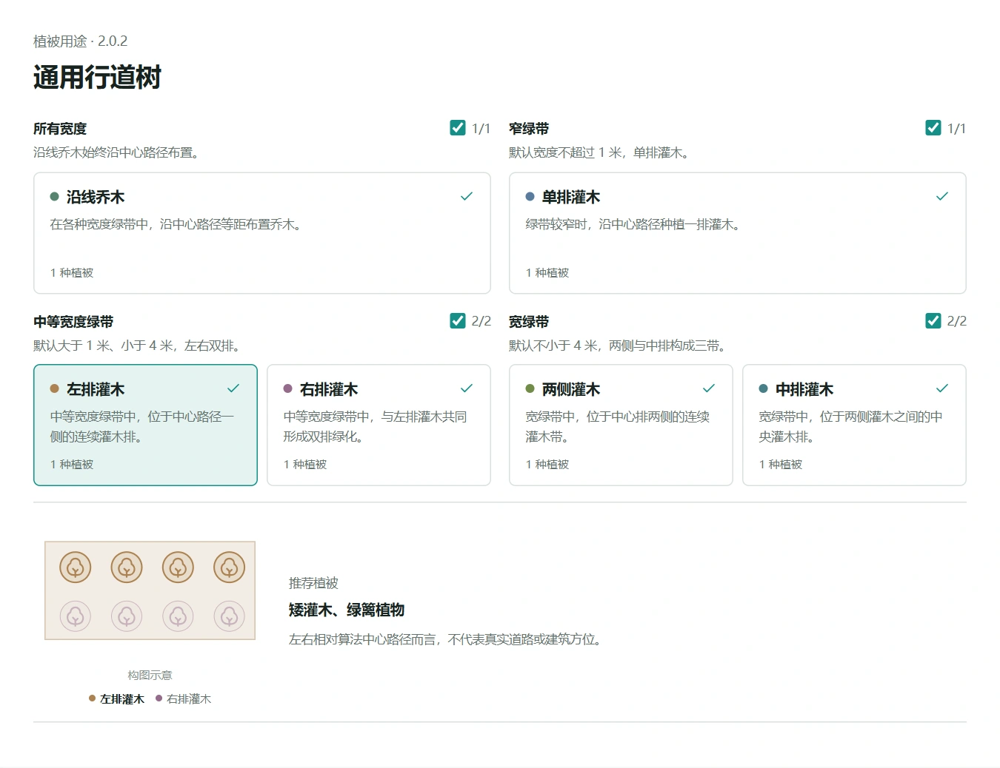

# 通用行道树

面向道路分隔带、道路附属绿带与主轴明确的狭长地块。策略从地块推导中心路径，沿路径布置乔木，并根据局部宽度组织灌木。

## 根据地块宽度组织植被

| 局部宽度 | 灌木组织方式 |
| --- | --- |
| 不超过 1 米 | 中心单行 |
| 大于 1 米、小于 4 米 | 左右双带 |
| 不小于 4 米 | 两侧与中心三带 |

各模式均可沿中心路径布置乔木。推荐使用狭长、连续、方向明确的面状地块；遇到明显分叉或收缩时，建议先拆分地块。
具体植被、角色显隐与缩放仍由植被搭配决定。

## 调整种植效果

可调整乔木沿线间距、灌木沿线株距、三排灌木横向排距、乔木端部留距，以及乔木周边灌木留空。
横向排距指中排到任一外排的距离，默认 1.55 米。较窄处按可用宽度自动收缩，仍检查外边界与孔洞。
包内提供由窄到宽的道路绿带示例，可观察三种排布及参数变化。

**2.1.1** 修复外排灌木达到最小边界净距时因浮点误差漏点的问题，不改变角色和地块输入。
下载 VFS 导入策略库后，需单独确认信任新版；资源中心不执行策略或授予信任。

[策略使用指南](https://mr-pardon.github.io/verdflow-site/resources/strategies.html)

作者：**Mr_Pardon**。策略代码按 **Apache-2.0** 发布。
